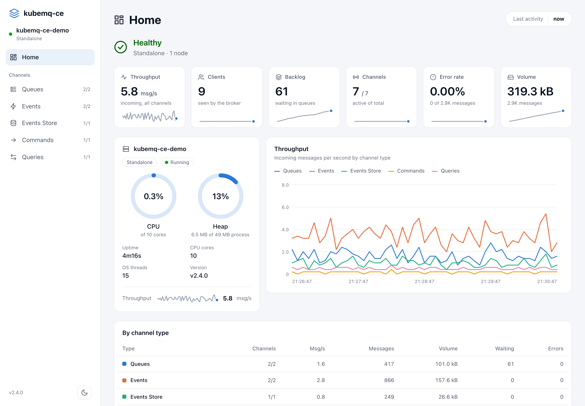
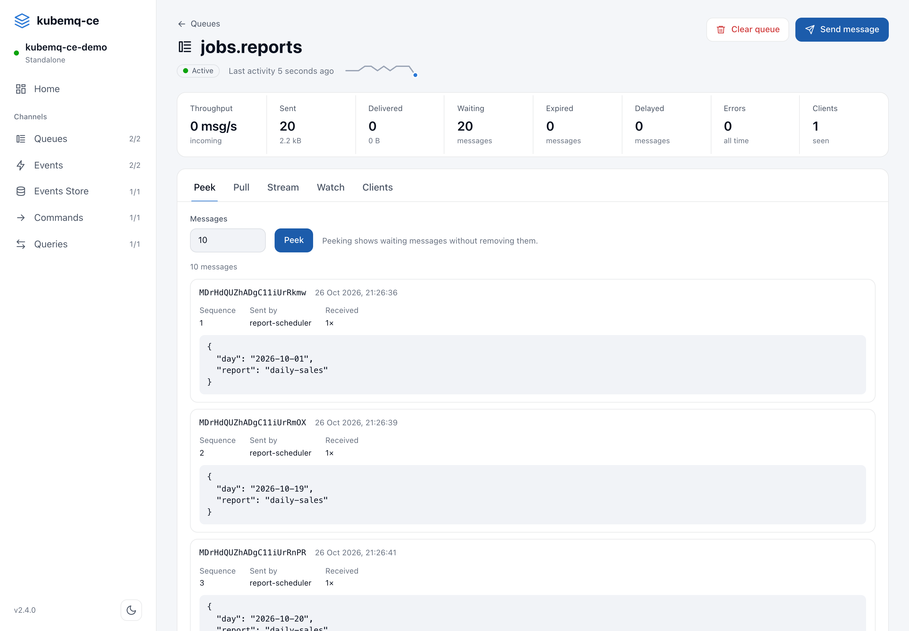

# kubemq-ce

A self-hosted message broker for queues, pub/sub and request/reply, in a single binary with a built-in web dashboard. It speaks gRPC and REST, and runs anywhere from a laptop to a Kubernetes pod.

kubemq-ce is a fork of [KubeMQ Community](https://github.com/kubemq-io/kubemq-community), licensed under Apache-2.0 like upstream.

<picture>
  <source media="(prefers-color-scheme: dark)" srcset="images/dashboard-dark.png">
  
</picture>

## How it differs from upstream

- **No usage reporting.** Upstream sends hostname, a host fingerprint, message counts and environment to `api.kubemq.io` at startup and every 5 minutes. That code is gone.
- **Runs on Kubernetes.** Upstream refuses to start inside a Kubernetes pod. kubemq-ce starts there like it does anywhere else.
- **A new dashboard, built from source.** Upstream ships its dashboard only as a compiled bundle. This one lives in [`web/`](web) (Vue 3 + Vite) and covers every channel type. See [Web dashboard](#web-dashboard).
- **Authentication.** Upstream's community edition has authentication settings but ignores them. Here, gRPC and REST clients can be required to send a JWT, and the dashboard asks for one at sign-in. Tokens can be revoked one by one, rules can limit each token to some channels, and an audit log records who did what. See [Authentication](#authentication).
- **Channel management from the SDKs.** The SDKs' create, list and delete channel calls work. Upstream only answers them in the commercial edition.
- **OpenTelemetry tracing.** Traces follow each message from producer through the broker to its consumers. See [Tracing](#tracing).
- **CloudEvents and MCP.** Anything that can POST a [CloudEvent](#cloudevents) can publish, and AI agents can use the broker through a built-in [MCP server](#mcp-server-for-ai-agents).
- **Maintained storage.** Upstream runs on its own fork of NATS Streaming, which is deprecated. Here, messages are kept in JetStream on the current `nats-server`. See [Storage](#storage).
- **Current dependencies.** Go 1.26 and up-to-date gRPC, Prometheus, echo and NATS libraries.
- **Fixes.** The dashboard no longer shows another server's metrics when two run on the same host, and links to individual channels work on reload.

The server is single-node: several replicas are separate brokers with separate storage, not a cluster.

The upstream Docker image (`kubemq/kubemq-community`) and release binaries don't include any of this. Build from this repository.

## Quick start

There are no prebuilt images or binaries yet.

### Docker

```bash
docker build --build-arg VERSION=v2.4.0 -t kubemq-ce .
docker run -d -p 8080:8080 -p 50000:50000 -p 9090:9090 kubemq-ce
```

Then open [http://localhost:8080](http://localhost:8080).

### From source

Requires Go 1.26 or later. The dashboard is committed in `assets/` and embedded in the binary, so Node.js is only needed if you change it.

```bash
task build          # or: go build -o kubemq -ldflags "-X 'main.version=v2.4.0'" .
./kubemq server
```

### Kubernetes

Run the image as a single replica and mount a persistent volume at `/kubemq/store` so messages survive pod restarts.

Set the `HOST` environment variable to a fixed name, or use a StatefulSet. The store path includes the host name, which defaults to the pod's. A Deployment's pod gets a new name on each restart, so it would start with an empty store and leave the previous directory on the volume for good.

A Deployment also needs the `Recreate` strategy. A rolling update can run the new pod next to the old one, and two servers writing to one store lose messages, because nothing locks it.

```yaml
strategy:
  type: Recreate
template:
  spec:
    containers:
      - name: kubemq
        env:
          - name: HOST
            value: kubemq
```

### Ports

| Port | Serves | Override |
|---|---|---|
| 8080 | Web dashboard and its API | `API_PORT` |
| 50000 | gRPC | `GRPC_PORT` |
| 9090 | REST and websockets | `REST_PORT` |

## Configuration

The server reads `config.yaml` from the directory of the binary, or from the working directory. You can also point the `CONFIG` environment variable at a file, or pass the whole file base64-encoded. On startup it writes the effective configuration back to that file. Data is stored in `./store` by default.

Any setting can be overridden with an environment variable named after its path: `Section.Field` becomes `SECTION_FIELD`, for example `API_PORT`, `QUEUE_MAX_RECEIVE_COUNT` or `STORE_STORE_PATH`.

### Storage

Queues and events store keep their messages in an embedded JetStream, in `<store.storePath>/<host>/jetstream`, with one stream per channel. Nothing listens on a NATS port; the broker's clients connect in-process.

| Setting | Default | Meaning |
| --- | --- | --- |
| `store.maxRetention` | `1440` | Minutes a message is kept, `0` for no limit. Also how long a subscriber without a group keeps its position while away. |
| `store.maxMessages`, `store.maxQueueSize` | `0` | Messages and bytes per channel, `0` for no limit. The oldest go first. |
| `store.maxQueues` | `0` | Stored channels, `0` for no limit. Sending to one more fails. |
| `store.maxPurgeInactive` | `1440` | Minutes after which a channel with no new messages and no subscribers is deleted, messages included. `0` keeps it. |
| `store.maxStorage`, `store.maxMemory` | `0` | Bytes JetStream may use on disk and in memory, `0` to let it choose from the machine's resources. |
| `broker.diskSyncSeconds` | `60` | Seconds between syncs to disk. A power loss can lose what was written since the last one. |

A stored message can be at most about 32 MiB, a limit of JetStream's file store; a larger one is refused with `message too large`. Events, commands and queries aren't stored, so `broker.maxPayload` (100 MiB) applies to them.

Upgrading from a version that used NATS Streaming starts with empty queues and events store channels. The old files aren't read or removed, and the server logs a warning when it finds them. Drain queues first if their messages matter.

### Authentication

Clients can be required to send a JWT. It is off by default. To turn it on:

```yaml
authentication:
  enable: true
  jwtConfig:
    signatureType: HS256        # HS256/384/512, RS/PS/ES 256/384/512 or EdDSA
    key: "a long random secret" # the HMAC secret, or a PEM public key for the other types
    # filePath: /run/secrets/kubemq-jwt-key   # instead of key
```

or `AUTHENTICATION_ENABLE=true`, `AUTHENTICATION_JWT_CONFIG_SIGNATURE_TYPE=HS256` and `AUTHENTICATION_JWT_CONFIG_KEY=...`. The server writes its effective configuration back to `config.yaml`, so a key given in an environment variable ends up in that file too. Use `filePath` to keep the key out of it.

Create tokens with the binary, using the same configuration:

```bash
./kubemq token --subject orders-service --ttl 720h          # HMAC: signed with the configured secret
./kubemq token --subject orders-service --signing-key key.pem  # other types: the matching private key
```

Without `--ttl` the token never expires. The server checks the signature, the algorithm and, if present, the expiry. The subject names who the token is for: [permissions](#permissions) and the [audit log](#audit-log) use it. `kubemq token` also prints the token's ID to stderr; keep it, so you can [revoke](#revoking-tokens) that one token later.

Clients send the token in the `authorization` gRPC metadata key or the `Authorization` HTTP header, with or without `Bearer `. The SDKs do this when given a token: `credentials` in kubemq-js, `WithAuthToken` in kubemq-go. The `kubemq` CLI uses `client.authToken` from `config.yaml`.

With authentication on, gRPC (port 50000) and REST (port 9090) reject other requests with `Unauthenticated` or `401`. Only `Ping` and `GET /ping` are open, for health checks. Use TLS (the `security` section) so tokens aren't sent in clear text.

The dashboard (port 8080) shows a sign-in page that asks for a token. The server keeps it in an HttpOnly cookie until the token expires or you sign out; tokens without `--ttl` last until the browser closes. Its API, `/metrics`, `/config` and `/v1/stats` also accept the token as an `Authorization: Bearer` header, so point Prometheus at `/metrics` with a bearer token. `/health` and `/ready` stay open for probes.

#### Revoking tokens

To cut off a leaked token without changing the key, list its ID in a file:

```yaml
authentication:
  revokedTokensFile: /etc/kubemq/revoked-tokens
```

```text
# one token ID per line; text after # is ignored
1Zq3dFh0mPZgk6Y8lK2x7B   # leaked in a CI log, 2026-10-29
```

The server rereads the file within 5 seconds of a change, so revoking needs no restart, and a mounted Kubernetes ConfigMap works. Tokens made before token IDs existed have none and can only be revoked by changing the key.

#### Permissions

Every valid token can do everything until you add authorization rules. With rules, a request is allowed only when a rule allows it:

```yaml
authorization:
  enable: true            # needs authentication
  policyData: |
    - subject: orders-service      # the token's subject, or * for any
      channels: ["orders.*"]       # * matches any characters, dots included
      types: [queues, events]      # optional: events, events_store, commands, queries, queues
      actions: [send, receive]
    - subject: ops
      channels: ["*"]
      actions: ["*"]               # send, receive, manage and admin
  # filePath: /etc/kubemq/rules.yaml   # instead of policyData
  # autoReload: 10                     # recheck filePath every 10 seconds
```

The actions are:

- `send`: publish events, send queue messages (including to a message's dead-letter queue) and send commands and queries.
- `receive`: subscribe, receive, peek, stream and acknowledge queue messages, and answer commands and queries.
- `manage`: create and delete channels from the SDKs. Channel lists only show the channels you may manage.
- `admin`: the dashboard and its API, which can do anything. A rule that only grants `admin` needs no `channels`.

Refused requests get `PermissionDenied` on gRPC and `403` on REST. On a stream, such as an SDK's queue upstream, only the refused message gets an error and the stream stays open. A subscription to a wildcard channel such as `orders.>` is checked as written, so it needs a pattern that covers that text, like `orders.*`.

#### Audit log

```yaml
audit:
  enable: true
  filePath: /var/log/kubemq/audit.log   # empty: the server log
```

The audit log has one JSON line per request with the time, transport, remote address, subject, token ID, client ID, operation, action, channel type, channel and outcome (`allowed`, `denied` or `unauthenticated`). On a stream, each channel is logged once per stream rather than per message. On the dashboard, sign-ins, actions and opened subscriptions are logged, but not page refreshes. It works without authentication too, without subjects.

### Tracing

The server can export OpenTelemetry traces over OTLP to any collector (Jaeger, Tempo, Honeycomb, the OpenTelemetry Collector, and so on). It is off by default:

```yaml
tracing:
  enable: true
  endpoint: otel-collector:4317   # empty: OTEL_EXPORTER_OTLP_ENDPOINT, or localhost
  protocol: grpc                  # or http, usually port 4318
  insecure: true                  # no TLS to the collector
  serviceName: kubemq
  sampleRatio: 1                  # share of new traces to record, 0 to 1
```

Each gRPC call and REST request gets a server span, continuing the trace a client sends in its `traceparent` metadata or header. Ping, `/ping` and websocket connections get none. Each message the broker accepts gets a `send <channel>` span, and each hand-off to a subscriber or consumer a `receive <channel>` span. The trace context travels in the message's tags as `traceparent` (and `tracestate`), stored with the message for queues and events store. A consumer that reads `traceparent` from the tags can continue the trace, and a producer that sets it there gets its own span as the parent. Standard `OTEL_EXPORTER_OTLP_*` and `OTEL_RESOURCE_ATTRIBUTES` environment variables work for anything not covered above, such as headers.

## Web dashboard

The dashboard runs on port 8080, next to the broker.

- **Home**: health, throughput, queue backlog, error rate and volume, CPU and heap for the node, a throughput chart by channel type, and the busiest channels.
- **Channel lists**: one page each for queues, events, events store, commands and queries, with search, an active-only filter and per-channel rates. You can create channels and send messages from here.
- **Channel pages**:
  - **Queues**: peek at or pull waiting messages, stream messages one at a time and acknowledge or reject each, and clear the queue.
  - **Events and events store**: subscribe live, optionally in a consumer group. Events store subscriptions can replay from the first or last message, a sequence number, a point in time, or a number of seconds ago.
  - **Commands and queries**: receive requests and answer them by hand, or reply to them automatically.
  - **Every type**: watch a channel's traffic without consuming it, list its clients, and delete the channel. Deleting a queue or events store channel deletes its stored messages too.

<picture>
  <source media="(prefers-color-scheme: dark)" srcset="images/queue-dark.png">
  
</picture>

> [!WARNING]
> Unless [authentication](#authentication) is on, the dashboard has no sign-in: anyone who can reach port 8080 can read, send and delete messages. With it on, the dashboard is still plain HTTP, so the session cookie crosses the network unencrypted. Either way, don't expose port 8080 to untrusted networks directly: publish it only on localhost (`-p 127.0.0.1:8080:8080`) or put it behind a proxy that terminates TLS.

## Clients

The `kubemq` binary is also a command-line client:

```bash
./kubemq queues send jobs.email '{"to": "someone@example.com"}'
./kubemq queues receive jobs.email
./kubemq events receive orders.created
```

See the CLI reference for [queues](docs/cli/kubemq_queues.md), [events](docs/cli/kubemq_events.md), [events store](docs/cli/kubemq_events_store.md), [commands](docs/cli/kubemq_commands.md) and [queries](docs/cli/kubemq_queries.md).

kubemq-ce keeps upstream's gRPC and REST API, so the upstream KubeMQ SDKs connect to it: [Go](https://github.com/kubemq-io/kubemq-go), [Java](https://github.com/kubemq-io/kubemq-Java), [Python](https://github.com/kubemq-io/kubemq-Python), [Node](https://github.com/kubemq-io/kubemq-js) and [C#](https://github.com/kubemq-io/kubemq-CSharp). Upstream's [documentation](https://docs.kubemq.io/) explains the messaging patterns. The SDKs' channel management calls (`createChannel`, `listChannels`, `deleteChannel` and their per-type variants) work too, and so does the query cache: a query with a cache key gets the stored response of an earlier query with the same key on the same channel, marked as a cache hit, until its TTL runs out. The SDKs disagree on the TTL's unit, so values under 1000 are read as seconds and larger ones as milliseconds.

### CloudEvents

The REST port accepts [CloudEvents](https://cloudevents.io) 1.0 in any HTTP mode: binary (`ce-*` headers), structured (`application/cloudevents+json`) or batched (`application/cloudevents-batch+json`).

```bash
curl -X POST localhost:9090/cloudevents/queues/orders.new \
  -H 'ce-specversion: 1.0' -H 'ce-id: 42' -H 'ce-source: /shop' -H 'ce-type: order.created' \
  -H 'content-type: application/json' -d '{"total": 10}'
```

The path is `/cloudevents/<events|events_store|queues>/<channel>`. Without a channel, the event's type is used. Each event becomes one message: its ID is the message ID, its source the client ID, its type the metadata and its data the body. Every attribute is also kept as a `ce-<name>` tag. The server answers `202` once every event is sent.

### MCP server for AI agents

The dashboard port serves a [Model Context Protocol](https://modelcontextprotocol.io) server at `/mcp` (streamable HTTP). Its tools are `list_channels`, `get_stats`, `send_message` and `peek_queue`. With authentication on, give the agent a token as a Bearer header. With permissions on, each tool needs what the same request from a client would: `send` to send, `receive` to peek, and `manage` for the channels it lists. The agent doesn't need `admin`.

```bash
claude mcp add --transport http kubemq http://localhost:8080/mcp --header "Authorization: Bearer $(./kubemq token --subject agent)"
```

## Development

```bash
task build_all                                       # rebuild the dashboard, then the binary
npm --prefix web ci && npm --prefix web run dev      # dashboard dev server with hot reload
go test ./...                                        # tests (the integration tests take several minutes)
task smoke -- localhost:50000                        # kubemq-js SDK smoke test against a running server
task bench -- -addr localhost:50000 -out new.json    # benchmarks against a running server
```

The dashboard dev server proxies API calls to a broker on `http://localhost:8080`. Set `BROKER_URL` to use another one. Run `task web` and commit `assets/` after changing the dashboard, since `go build` embeds whatever is there.

`task smoke` runs [`test/smoke-js`](test/smoke-js/smoke.mjs), which exercises every messaging pattern through the official Node SDK (kubemq-js, pinned in its `package.json`). Set `KUBEMQ_TOKEN` when authentication is on. It writes to fresh `smoke.<id>.*` channels on the target server, and needs a token that may send, receive and manage them.

`task bench` runs [`test/bench`](test/bench/main.go), which measures every messaging pattern over gRPC against a server you started, so it works with any build. Each scenario runs three times and prints medians, and anything sent but never received is reported as lost. It writes to fresh `bench.<id>.*` channels and deletes them after each run. It stores up to 1 GiB per scenario (`-budget`), so give it a server you don't mind loading.

```bash
kubemq server                                                     # with the build to measure, on a fresh store
go run ./test/bench -label new -pid $(pgrep -x kubemq) -out new.json
go run ./test/bench compare old.json new.json                     # marks changes within the spread of the runs as noise
go run ./test/bench -list                                         # the scenarios; -run takes a regular expression
```

With `-pid` it also reports the server's memory and CPU time. The tool runs on the same machine as the server unless you point `-addr` elsewhere, and then shares its CPU, so compare runs made the same way.

Report bugs in this repository's [issues](https://github.com/tengla/kubemq-ce/issues).

## License

[Apache License 2.0](LICENSE). KubeMQ is a trademark of its owner; this project is not affiliated with or endorsed by KubeMQ.
